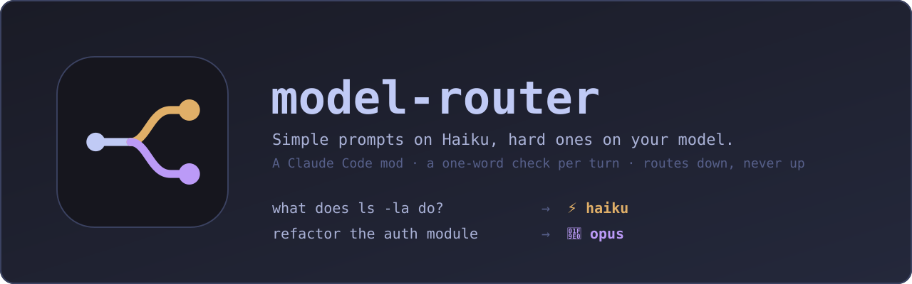
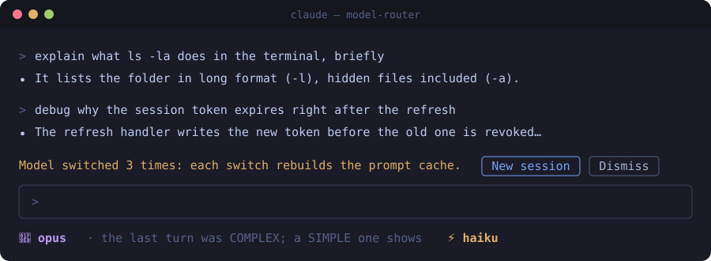

<p align="center">
  
</p>

# model-router

> A Claude Code mod that runs simple prompts on **Haiku** and keeps the model you picked with `/model` for the hard ones, **to save cost**.

Before each turn, Haiku reads your prompt and answers one word: `SIMPLE` (it can handle it) or `COMPLEX` (it needs the stronger model, e.g. Opus). A simple turn runs entirely on Haiku; a complex one runs on your model, unchanged. The status line shows which one is answering.

```
you type:     explain what ls -la does in the terminal, briefly
router:       SIMPLE   →  status line: ⚡ haiku

you type:     debug why the session token expires after the refresh, it touches auth and the API client
router:       COMPLEX  →  status line: 🧠 opus
```



> The images in this README are illustrations of the mod's output, drawn with the exact text it uses; they are not screen captures.

---

## Table of contents

- [Why](#why)
- [Install](#install)
- [How it works](#how-it-works)
- [What counts as simple](#what-counts-as-simple)
- [The status line](#the-status-line)
- [The switch warning](#the-switch-warning)
- [Benchmarks](#benchmarks)
- [Project structure](#project-structure)
- [Tests](#tests)
- [Development](#development)
- [Customizing](#customizing)
- [Limits and known trade-offs](#limits-and-known-trade-offs)
- [FAQ](#faq)
- [License](#license)

---

## Why

Most sessions mix hard work (debugging, refactors, design) with small questions (what does this flag do, rename this, fix this typo). Running the small ones on Opus costs far more than they need. Switching by hand with `/model` every few turns is tedious, so nobody does it.

This mod makes the choice for you, per turn, with a one-word classification on Haiku that costs about $0.00002. It only ever routes **down**: it never picks a model stronger than the one you chose.

---

## Install

At the prompt of a Claude Code terminal session:

```
/plugin install model-router --marketplace webdiego/model-router
```

What you will see:

1. `Add marketplace?` naming `github:webdiego/model-router`: answer `y`.
2. The plugin's details and a choice of scope: pick **user** (applies to every session) with Enter.
3. `Installed model-router. Plugin is now active.` The mod runs from the next prompt; there are no options to set.

From a shell:

```
claude plugin install model-router --marketplace webdiego/model-router
```

In the desktop app, where `/plugin` does not run: click **+** next to the prompt box, then **Plugins**, **Add marketplace** with `webdiego/model-router`, then **Add plugin**.

To remove it, from a shell:

```
claude plugin uninstall model-router
```

---

## How it works

The mod is a single hooks module, [`hooks/register.tsx`](hooks/register.tsx), with five hooks.

### 1. `turn.start`: classification

Fires once per turn, before the model is called.

1. Subagent turns (`e.agentId` set) and turns with no typed text (continuations) are skipped.
2. The prompt (its first 4000 characters) is sent to Haiku inside a fixed instruction ([below](#what-counts-as-simple)), with `maxTokens: 16` (`MAX_TOKENS` in `hooks/classify.ts`; at 5 the reply was cut to `SIMPL`), `effort: 'low'` and a **4 s timeout**.
3. `isCheap()` reads the reply: only a reply that **starts with** `SIMPLE` counts. Anything else (`COMPLEX`, an empty reply, "I think SIMPLE") keeps the strong model.
4. **Fail safe.** A timeout, an API error, or the hook throwing (its `.catch` passes the turn on untouched) all keep your model: the mod never downgrades by accident.
5. **Cost check.** A simple prompt goes to Haiku only if that is cheaper once both prompt caches are counted ([below](#when-a-simple-prompt-stays-on-your-model)).
6. A Haiku turn's id is remembered, the status line is updated, and the switch counter moves if the choice changed ([the switch warning](#the-switch-warning)).

Every prompt is classified, short ones too.

### When a simple prompt stays on your model

Haiku is 40 times cheaper than Opus per token, but each model has its own prompt cache, and the context (Claude Code's system prompt, the conversation, the files read) can be tens of thousands of tokens. Re-writing 50,000 tokens into Opus's cache costs $0.25, more than a dozen Haiku turns save. So `cheaper()` prices the turn both ways from what the session has measured:

| | On your model | On Haiku |
|---|---|---|
| Context | read from its cache if used in the last 5 minutes, else re-written | read from Haiku's cache if warm, else written |
| Output | the average output of past turns, at its price | the same, at Haiku's price |
| Penalty | | if your model's cache is warm now but will have expired by the next turn (the average gap between turns), re-writing it then |

The cheaper side wins. In practice:

- **a quick question in the middle of Opus work** goes to Haiku: Opus's cache is still warm when you come back;
- **a run of simple turns** stays on Haiku until Opus's cache is about to expire on a large context; then one simple turn runs on Opus to keep its cache, and the status line says `🧠 opus (keeps its cache)`;
- **after a break of more than 5 minutes** Opus's cache is cold anyway, so Haiku has nothing to lose;
- **on a small context** the re-write is cheap, so Haiku wins even near the expiry.

The context size is the last request's tokens (input, cache reads and writes, output); output and gap are moving averages, starting at 500 tokens and one minute. Claude Code caches for 5 minutes or 1 hour and does not tell a mod which; the mod assumes 5 (`CACHE_TTL_MS`). If your cache lasts an hour, that only makes it keep Opus a little more often than needed: it can miss savings, never cost more.

### 2. `turn.step`: running the turn on Haiku

Each step of a remembered turn (every model call in it, tool loops included) is passed on with `model: 'haiku'`. Other turns and subagents are passed on unchanged, so they use the session's model.

The hook also reads each step's `stop` chunk, which carries the tokens the API reported, to [measure the savings](#live-savings-in-the-status-line).

### 3. `turn.complete`: cleanup

The turn's id is forgotten, and its output tokens update the average the cost check uses.

### 4. `session.end`: reset

`/clear` ends the session without reloading the mod, so the switch counter, the last choice, the savings, the cache timings and the warning are reset here.

### 5. `ui.render` on `AbovePrompt`: the switch warning

Draws [the band](#the-switch-warning) above the prompt while the warning flag is on, unless a survey is showing there.

---

## What counts as simple

The instruction Haiku gets, verbatim:

```
You route prompts for a coding assistant. Reply with one word.
SIMPLE: a factual question, explaining a short snippet, a rename, a typo, a one-line or one-file trivial edit, formatting, a shell one-liner, translating text.
COMPLEX: debugging, architecture or design, multi-file changes, refactors, new features, security, performance, anything ambiguous.
When unsure, reply COMPLEX.
```

| Goes to Haiku (`SIMPLE`) | Stays on your model (`COMPLEX`) |
|--------------------------|----------------------------------|
| "what does `git rebase --onto` do?" | "this test fails only in CI, find out why" |
| "rename `userId` to `accountId` in this file" | "split this module into a service and a repository" |
| "fix the typo in the README title" | "add OAuth login" |
| "a one-liner to count lines in all `.ts` files" | "is this endpoint safe against SQL injection?" |
| "translate this paragraph to English" | "yes, do it" (no context: unsure, so complex) |

---

## The status line

| Shown | Meaning |
|-------|---------|
| `⚡ haiku` | this turn runs on Haiku |
| `🧠 <model>` | this turn runs on the session's model, as `/model` set it (e.g. `🧠 opus`) |
| `🧠 <model> (keeps its cache)` | the prompt was simple, but running it on Haiku would have let your model's cache expire ([why](#when-a-simple-prompt-stays-on-your-model)) |
| `· saved $0.42 (61%)` | what the router saved in this session so far ([how it is measured](#live-savings-in-the-status-line)) |

---

## The switch warning

Each model keeps its own prompt cache. Every time the router switches model, the whole conversation is written into the other model's cache again, which costs tokens and can eat the savings in a long session.

After **3 switches** in a session, a yellow band appears above the prompt:

```
Model switched 3 times: each switch rebuilds the prompt cache.  [New session]  [Dismiss]
```

- **New session** runs `/clear`: a fresh session starts with an empty cache and the counter at zero.
- **Dismiss** hides the band; it does not come back in this session.

The band's flag lives in plugin state (`showSwitchWarning`, typed in [`types/index.d.ts`](types/index.d.ts)).

---

## Benchmarks

Two measurements answer two different questions: **how much does it actually save** (live, on your real sessions) and **how well does Haiku route** (offline, on a fixed set of prompts).

### Live savings in the status line

Every model call of the session is priced twice, from the tokens the API reported in the step's `stop` chunk:

- **spent**: the tokens at the price of the model that answered, plus every classification call on Haiku;
- **baseline**: the same tokens at the price of the session's model, as if the router were off.

The status line shows `baseline − spent` and the share of the baseline it is. The switch cost is in the measure: after a switch, the model that takes over writes the whole context into its cache, and `spent` pays for those writes; in the baseline that first step is priced as cache reads, since with no switch the cache would have stayed warm.

Prices, in $ per million tokens (`PRICES` in `hooks/register.tsx`; a cache write is 1.25× input):

| Model family | Input | Output | Cache read |
|--------------|-------|--------|------------|
| Opus | 4.00 | 20.00 | 0.20 |
| Sonnet | 2.00 | 10.00 | 0.20 |
| Haiku | 0.10 | 0.50 | 0.01 |
| Fable / Mythos | 10.00 | 50.00 | 0.25 |

What the baseline cannot know:

- **The strong model would have written a different answer.** The baseline prices Haiku's own token counts (its output length, its tool loop) at the strong model's rates.
- **The first step of every switched turn is priced as warm** in the baseline, including the new message's own tokens, which would have been written anyway. This makes the baseline slightly low, so the savings shown lean conservative.
- **Prices are matched by family**, at 5.5 rates: an older Opus (4.x at $5 / $25) is priced as Opus 5.5. Haiku above 100K-token prompts ($0.50 / $2.50) is priced at the base rate. Haiku's cache read price is taken as 0.1× input.
- **A model not in the table costs 0**, so a session on one shows no savings.

### Offline classifier benchmark

[`bench/run.ts`](bench/run.ts) sends every prompt of [`bench/prompts.json`](bench/prompts.json) (40 prompts, English and Italian, each labelled simple or complex) to Claude Haiku 5.5 with the mod's own instruction and reply parser (both imported from [`hooks/classify.ts`](hooks/classify.ts)), and reports:

- **routed right**: the share labelled as the mod would want;
- **sent to Haiku wrong**: complex prompts Haiku took on itself, the errors that cost quality;
- **kept strong wrong**: simple prompts kept on the strong model, which only cost missed savings;
- **latency p50 / p95** of the classification, which every turn waits for;
- **classifier cost** per prompt.

Each misrouted prompt is printed with Haiku's reply. Run it with an API key (the 40 calls cost well under a cent):

```
cd bench
npm install
ANTHROPIC_API_KEY=sk-ant-... npm start
```

Last run (2026-10-24, Claude Haiku 5.5):

```
prompts             40
routed right        40 (100%)
sent to Haiku wrong 0 (0%)   quality risk: a hard task answered by Haiku
kept strong wrong   0 (0%)   missed savings only
latency p50 / p95   843 ms / 1553 ms
classifier cost     $0.000022 per prompt, $0.0009 total
```

The first run, at `max_tokens: 5`, routed only 50% right: every simple prompt came back as `SIMPL`, cut by the limit, so nothing ever went to Haiku. That is why the limit is now 16.

It calls the API directly with thinking off, while the mod goes through Claude Code's own `model.complete`, so latency in a session can differ. Add your own prompts to `prompts.json` to test the cases you care about.

---

## Project structure

```
model-router/
├── .claude-plugin/
│   ├── plugin.json          # mod manifest: name, version, description, icon
│   ├── icon.png             # 1024×1024 plugin icon
│   └── marketplace.json     # makes this repo installable with one line
├── bench/
│   ├── run.ts               # offline classifier benchmark
│   ├── prompts.json         # labelled prompts it routes
│   └── package.json         # the Anthropic SDK, for the benchmark only
├── docs/                    # logo, banner and README illustrations (SVG)
├── hooks/
│   ├── hooks.json           # points the engine at register.tsx
│   ├── classify.ts          # the classifier prompt (ASK) and isCheap(), shared with the benchmark
│   ├── register.tsx         # the mod: prices, cost(), hooks, the band
│   └── register.test.ts     # unit and integration tests
├── types/
│   └── index.d.ts           # state contract: the band's showSwitchWarning flag
├── tsconfig.json            # extends the types the engine writes on load
├── LICENSE
└── README.md
```

Exported so they can be tested on their own:

- `isCheap(reply: string): boolean` (`classify.ts`): the reply parser
- `cost(usage: ModelUsage, model: string, warm?: boolean): number` (`register.tsx`): the dollars a call cost; `warm` prices cache writes as reads
- `cheaper(moment: Moment, strong: string): boolean` (`register.tsx`): whether a simple turn costs less on Haiku, both caches counted

---

## Tests

Run them with:

```
claude plugin test .
```

The runner executes every `*.test.ts` / `*.test.tsx` in an environment like the one the mod's hooks run in, importing its kit from `claude-code/testing`. Nothing sits beneath the mod in a test: small hooks registered with `on(...)` stand in for the engine (answering `model.complete` with scripted replies, `session.model` with `claude-opus-5-5`, each `turn.step` with the tokens the test chooses, and drawing nothing for `ui.render`), and `mock.clock` holds the time still until the test moves it.

Current result:

```
hooks/register.test.ts:
(pass) the band shows after three switches and Dismiss hides it
(pass) a Haiku turn shows what it saved against the session model
(pass) a simple prompt stays on Opus when its cache would expire before the next turn
(pass) weighs both caches before sending a simple turn to Haiku
(pass) prices tokens per model, cache writes as reads when warm
(pass) parses the router reply, defaulting to the strong model

 6 pass
 0 fail
```

**`a simple prompt stays on Opus when its cache would expire before the next turn`** runs a complex turn on Opus over a 50,000-token context, moves the clock 4.5 minutes, then sends a simple prompt. Both steps reach the engine on `claude-opus-5-5`, and the status line reads `🧠 claude-opus-5-5 (keeps its cache)`.

**`weighs both caches before sending a simple turn to Haiku`** checks `cheaper()` at fixed moments (500 output tokens, one minute between turns):

| Context | Opus cache last used | Haiku cache last used | Goes to |
|---------|----------------------|-----------------------|---------|
| 50,000 | 1 min ago | never | Haiku |
| 50,000 | 4.5 min ago | 30 s ago | Opus |
| 1,000 | 4.5 min ago | never | Haiku |
| 50,000 | 10 min ago | never | Haiku |
| any, session model not priced | | | Haiku |

**`a Haiku turn shows what it saved against the session model`** runs a simple turn whose step reports 10,000 cache-write tokens and 1,000 output tokens. It checks the step reached the engine with `model: 'haiku'` and the status line reads `⚡ haiku · saved $0.02 (92%)`: $0.00175 on Haiku against $0.022 on a warm Opus.

**`prices tokens per model, cache writes as reads when warm`** checks `cost()`: a million Opus input tokens cost $4, a million Haiku output tokens $0.50, a million Opus cache writes $5 (or $0.20 when warm), and an unknown model $0.

**`the band shows after three switches and Dismiss hides it`** runs three turns through the real hook chain with Haiku answering `SIMPLE`, `COMPLEX`, `SIMPLE`, and mounts the `AbovePrompt` band on the terminal surface:

- after 2 switches, no band;
- after the 3rd, the band's text "Model switched 3 times" is drawn;
- pressing **Dismiss** removes it.

**`parses the router reply, defaulting to the strong model`** checks `isCheap()`:

| Reply | Result |
|-------|--------|
| `SIMPLE` | Haiku |
| ` simple.` | Haiku |
| `COMPLEX` | strong model |
| `I think SIMPLE` | strong model |
| *(empty)* | strong model |

Not covered: the **New session** button, and `turn.step` actually swapping the model on a live session (check it by hand with the status line).

---

## Development

Run Claude Code with the mod loaded straight from this folder:

```
claude --plugin-dir .
```

Validate the manifest and the module the way the engine will read them:

```
claude plugin validate .
```

Type-check (the engine writes the types into `.claude-plugin/types/` the first time it loads the mod):

```
npx tsc -p .
```

To see a switch by hand: send a simple prompt, then a complex one, then a simple one, watching the status line; the band appears after the third.

---

## Customizing

Everything lives in `hooks/register.tsx`, except the classifier's prompt and token limit, in `hooks/classify.ts`.

- **Change the cheap model:** change `CHEAP` (`'haiku'`).
- **Change what counts as simple:** edit the `SIMPLE:` / `COMPLEX:` lines of `ASK`. Keep "When unsure, reply COMPLEX" so mistakes cost money, not quality.
- **Warn sooner or later:** change `SWITCH_WARN_AT` (`3`).
- **Update prices:** edit `PRICES` (input, output, cache read per million tokens, matched by model family).
- **Your cache lasts an hour:** set `CACHE_TTL_MS` to `60 * 60_000`, so simple prompts stop staying on your model to keep a cache that was not about to expire.
- **Give the classifier more time:** change `timeoutMs` (`4000`) in the `turn.start` hook.

---

## Limits and known trade-offs

- **The classifier sees only the prompt, not the conversation.** A bare follow-up ("yes", "go on", "fix it") has no context, so it usually goes to the strong model, which can mean an extra switch.
- **Every turn costs one Haiku call** (about $0.00002: the prompt plus a one-word reply) and up to 4 s of waiting before the turn starts.
- **Switching rebuilds the prompt cache.** The [cost check](#when-a-simple-prompt-stays-on-your-model) avoids the switches that cost more than they save, and [the warning](#the-switch-warning) flags a session that switches a lot anyway.
- **The cost check predicts.** It assumes the next turn may need your model and comes after the usual gap; a turn that comes much later or never needs Opus again makes it keep Opus when Haiku would have been fine.
- **The cache lifetime is assumed**, at 5 minutes: Claude Code does not tell a mod whether it caches for 5 minutes or an hour.
- **It misjudges sometimes.** A hard task worded simply may run on Haiku; resend it reworded, or switch the mod off for that session.
- **Only the main loop is routed.** Subagents use whatever model they were given.
- **The switch count is per session**, held in memory: it starts over on `/clear` and on restart.

---

## FAQ

**Will it ever use a model stronger than mine?**
No. It only routes down to Haiku; a complex turn uses exactly the model `/model` set.

**My `/model` is already Haiku. Does it do anything?**
Every turn runs on Haiku either way; the classification is wasted. Switch the mod off.

**What happens if Haiku is down or slow?**
After 4 s, or on any error, the turn runs on your model as if the mod were not there.

**Does it send my prompt anywhere new?**
Only to Haiku, through the same Claude Code connection your session already uses.

---

## License

[MIT](LICENSE) © 2026 webdiego
